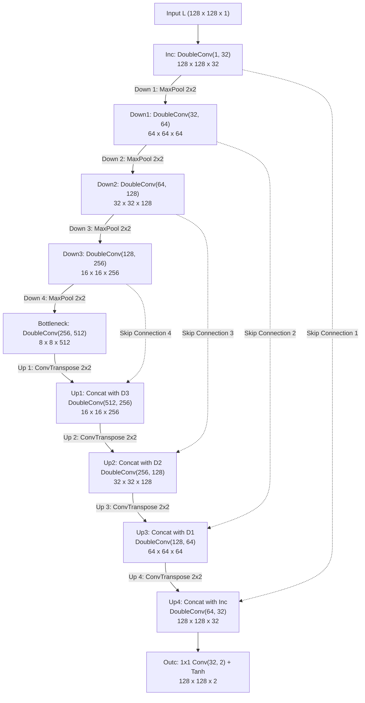

# CNN-Based Image Colorization Using Deep Learning

**A Deep Learning Project | Convolutional Neural Networks | CelebA Dataset**

## 1. Project Overview

This project aims to develop an automated image colorization system that converts grayscale images into color images using Convolutional Neural Networks (CNNs).

We will use the **CelebA (CelebFaces Attributes Dataset)**, which contains more than 200,000 celebrity facial images.

The model will learn to predict color information from grayscale images by studying the relationship between original color images and their grayscale counterparts.

The main objective is to develop and compare two CNN architectures:

1. Basic CNN (Baseline Model)
2. U-Net CNN (Primary Model)

The final generated images will be compared against their corresponding original color images to evaluate the performance of the models.

---

## 2. Problem Statement

Grayscale images contain brightness and structural information but do not contain explicit color information.

The objective is to develop a supervised Deep Learning model that can predict plausible colors from grayscale images.

The model will take a grayscale image as input, extract its features using CNN layers, and generate the missing color information.

**Input:** Grayscale image

**Output:** Predicted color image

**Goal:** Generate visually realistic color images while preserving the structure and details of the original image.

---

## 3. Dataset: CelebA

We will use the CelebA dataset because it contains a large collection of human facial images with variations in:

- Skin tones.
- Hair colors and hairstyles.
- Facial expressions.
- Facial structures.
- Backgrounds and lighting.

### Dataset Preparation

We will create paired training samples from the original RGB images.

Each original image will be converted into grayscale and LAB representations.

| Image component | Purpose |
|---|---|
| Original RGB | Ground truth |
| L channel | CNN input |
| a channel | First color target |
| b channel | Second color target |

### Dataset Split

| Dataset | Percentage |
|---|---:|
| Training | 80% |
| Validation | 10% |
| Testing | 10% |

The split will be performed before training to ensure that test images remain unseen.

---

## 4. Color Space: LAB

Instead of predicting all three RGB channels, we will use the CIELAB color space.

LAB consists of three channels:

- **L:** Lightness information.
- **a:** Green-to-red color information.
- **b:** Blue-to-yellow color information.

### Why LAB?

RGB combines brightness and color information across three channels.

LAB separates brightness from color, allowing the CNN to focus on predicting the missing color information.

### Our Approach

1. Convert the original RGB image into LAB.
2. Extract the L channel.
3. Provide the L channel to the CNN.
4. Predict the a and b channels.
5. Combine the original L channel with predicted a and b.
6. Convert the reconstructed LAB image into RGB.

Formula:

`Final LAB = [Original L, Predicted a, Predicted b]`

The reconstructed LAB image is then converted into RGB to generate the final colorized image.

---

## 5. CNN Models and Architecture

We implement and benchmark two distinct convolutional architectures for image colorization:
1. **Model 1: Basic CNN (Baseline Model)**
2. **Model 2: U-Net CNN (Primary Model with Skip Connections)**

---

### Detailed Component Descriptions

Each component of the neural network architectures is designed for specific feature extraction and reconstruction tasks:

#### 1. DoubleConv Block (`models/blocks.py`)
- **Structure:**
  $$\text{Input} \longrightarrow [\text{Conv2D}(3\times3) \to \text{BatchNorm2d} \to \text{ReLU}] \times 2 \longrightarrow \text{Output}$$
- **Role:** Applies two successive $3 \times 3$ convolutions with zero-padding ($p=1$) to preserve spatial resolution while capturing local receptive field patterns (textures, facial lines, color gradients).
- **Batch Normalization:** Stabilizes gradient propagation and speeds up convergence across mini-batches.
- **ReLU Activation:** Introduces non-linearity ($f(x) = \max(0, x)$) allowing representation of complex facial characteristics.

#### 2. Downsampling Block / DownBlock (`models/blocks.py`)
- **Structure:**
  $$\text{Input} \longrightarrow \text{MaxPool2D}(2\times2, \text{stride}=2) \longrightarrow \text{DoubleConv}(\text{in\_ch}, \text{out\_ch}) \longrightarrow \text{Output}$$
- **Role:** Halves the height and width ($H/2, W/2$) while doubling channel depth, allowing subsequent convolution layers to capture wider spatial contexts (head shapes, background lighting).

#### 3. Bottleneck Representation
- **Structure:** `DoubleConv(256, 512)` at spatial resolution $8 \times 8$.
- **Role:** The deepest layer of the network with the largest receptive field. Encodes abstract semantic representations of the face (overall skin tone, hair color category, background atmosphere) independent of high-frequency noise.

#### 4. Skip Connections (The Core of U-Net)
- **Mechanism:**
  $$\mathbf{F}_{\text{decoder\_in}} = \text{Concat}(\mathbf{F}_{\text{encoder\_skip}}, \text{Up}(\mathbf{F}_{\text{decoder\_prev}}), \text{dim}=1)$$
- **Why Skip Connections are Essential for Colorization:**
  - Standard downsampling discards high-frequency spatial boundaries (eyelid creases, lips, hair borders).
  - Skip connections copy early high-resolution feature maps directly across the network to corresponding decoder stages.
  - This prevents color bleeding across anatomical boundaries (e.g., prevents hair color from leaking onto the forehead or lips from bleeding onto skin).
  - Also acts as gradient highways that alleviate vanishing gradients during backpropagation.

#### 5. Upsampling Block / UpBlock (`models/blocks.py`)
- **Structure:**
  $$\text{Input } x_1 \longrightarrow \text{ConvTranspose2d}(2\times2, \text{stride}=2) \longrightarrow \text{Pad/Align} \longrightarrow \text{Concat with } x_2 \longrightarrow \text{DoubleConv} \longrightarrow \text{Output}$$
- **Role:** Reconstructs spatial resolution ($2\times$ upsampling), aligns spatial dimensions if mismatched, concatenates encoder skip features, and reduces channel dimensions.

#### 6. Output Layer & Tanh Activation
- **Structure:** $1 \times 1 \text{ Conv2D}(32 \to 2) \longrightarrow \tanh$
- **Role:** Maps the final 32 reconstructed feature channels down to the 2 target color channels ($a$ and $b$).
- **Bounded Range:** The $\tanh$ non-linearity strictly bounds predictions to $[-1.0, 1.0]$, corresponding to normalized CIELAB $a, b$ space ($[-128, 127]$).

---

### Model 1: Basic CNN (Baseline)

A plain sequential encoder-decoder network without skip connections:

```
Input L (128x128x1)
  │
  ▼
[Conv 1x32, 3x3] + BN + ReLU                  --> (128 x 128 x 32)
  │
  ▼
[Conv 32x64, stride 2] + BN + ReLU           --> (64 x 64 x 64)
  │
  ▼
[Conv 64x128, stride 2] + BN + ReLU          --> (32 x 32 x 128)
  │
  ▼
[Conv 128x256, stride 2] + BN + ReLU         --> (16 x 16 x 256)
  │
  ▼
[Conv 256x256, 3x3] + BN + ReLU              --> (16 x 16 x 256) [Bottleneck]
  │
  ▼
[ConvTranspose 256x128, stride 2] + BN + ReLU --> (32 x 32 x 128)
  │
  ▼
[ConvTranspose 128x64, stride 2] + BN + ReLU  --> (64 x 64 x 64)
  │
  ▼
[ConvTranspose 64x32, stride 2] + BN + ReLU   --> (128 x 128 x 32)
  │
  ▼
[Conv 32x2, 1x1] + Tanh                       --> (128 x 128 x 2) [Predicted ab]
```

---

### Model 2: U-Net CNN (Primary Model)

A multi-scale encoder-decoder with long skip connections bridging corresponding spatial resolutions:



#### Detailed Layer-by-Layer Dimension Trace

| Stage | Layer Name | Input Tensor Shape | Layer Operations | Output Tensor Shape |
|---|---|---|---|---|
| **Input** | `input` | `(B, 1, 128, 128)` | Lightness channel in $[0, 1]$ | `(B, 1, 128, 128)` |
| **Encoder 1** | `inc` | `(B, 1, 128, 128)` | `DoubleConv(1, 32)` ($3\times3$ Conv + BN + ReLU $\times 2$) | `(B, 32, 128, 128)` |
| **Encoder 2** | `down1` | `(B, 32, 128, 128)` | `MaxPool(2) -> DoubleConv(32, 64)` | `(B, 64, 64, 64)` |
| **Encoder 3** | `down2` | `(B, 64, 64, 64)` | `MaxPool(2) -> DoubleConv(64, 128)` | `(B, 128, 32, 32)` |
| **Encoder 4** | `down3` | `(B, 128, 32, 32)` | `MaxPool(2) -> DoubleConv(128, 256)` | `(B, 256, 16, 16)` |
| **Bottleneck**| `bottleneck` | `(B, 256, 16, 16)` | `MaxPool(2) -> DoubleConv(256, 512)` | `(B, 512, 8, 8)` |
| **Decoder 1** | `up1` | `(B, 512, 8, 8)` | `Up(2x) -> Cat(down3: 256) -> DoubleConv(512, 256)` | `(B, 256, 16, 16)` |
| **Decoder 2** | `up2` | `(B, 256, 16, 16)` | `Up(2x) -> Cat(down2: 128) -> DoubleConv(256, 128)` | `(B, 128, 32, 32)` |
| **Decoder 3** | `up3` | `(B, 128, 32, 32)` | `Up(2x) -> Cat(down1: 64) -> DoubleConv(128, 64)` | `(B, 64, 64, 64)` |
| **Decoder 4** | `up4` | `(B, 64, 64, 64)` | `Up(2x) -> Cat(inc: 32) -> DoubleConv(64, 32)` | `(B, 32, 128, 128)` |
| **Output** | `outc` | `(B, 32, 128, 128)` | `1x1 Conv(32, 2) -> Tanh()` | `(B, 2, 128, 128)` |

---

## 6. Technologies Used

| Technology | Purpose |
|---|---|
| Python | Main programming language |
| PyTorch | CNN architecture and model training |
| OpenCV | Image processing and LAB conversion |
| NumPy | Numerical operations |
| Matplotlib | Image visualization and training graphs |
| Scikit-image | Image evaluation metrics |
| Google Colab | GPU-based model training |
| GitHub | Version control and project documentation |

**Why PyTorch?**

PyTorch allows us to build custom CNN architectures, implement training loops, perform backpropagation and manage model parameters.

It also helps us understand the internal working of the neural network rather than relying entirely on pre-trained models.

---

## 7. Model Training

The project uses **Supervised Learning** because we have both grayscale input images and their corresponding original color targets.

### Training Process

1. Load a batch of grayscale images.
2. Load their corresponding original LAB color targets.
3. Pass the L channel through the CNN.
4. Predict the a and b channels.
5. Calculate the prediction error.
6. Perform backpropagation.
7. Update model weights using the Adam optimizer.
8. Repeat the process across multiple batches and epochs.
9. Monitor validation loss and save the best model.

### Training Configuration

| Parameter | Initial Value |
|---|---|
| Framework | PyTorch |
| Image Resolution | 128 × 128 |
| Input Channels | 1 |
| Output Channels | 2 |
| Optimizer | Adam |
| Learning Rate | 0.001 |
| Loss Function | L1 Loss |
| Batch Size | 16 or 32 |
| Epochs | 30–50 |
| Activation | ReLU |
| Normalization | Batch Normalization |

These are initial settings and may be adjusted based on validation performance and available GPU resources.

### Loss Function: L1 Loss

L1 Loss measures the absolute difference between the predicted and original color values.

`L1 Loss = Mean(|Actual Color - Predicted Color|)`

A lower loss indicates that the predicted color values are closer to the target values.

---

## 8. Complete Project Workflow

Our implementation will follow these stages:

**Step 1: Dataset Collection**
- Download CelebA.
- Inspect original RGB images.

**Step 2: Preprocessing**
- Resize images to 128 × 128.
- Convert RGB to LAB.
- Extract L as input and ab as target.
- Normalize the channels.

**Step 3: Dataset Splitting**
- 80% Training.
- 10% Validation.
- 10% Testing.

**Step 4: Model Development**
- Implement Basic CNN.
- Implement U-Net CNN.
- Verify input and output dimensions.

**Step 5: Model Training**
- Configure L1 Loss and Adam.
- Train both models.
- Monitor training and validation loss.
- Save model checkpoints.

**Step 6: Image Generation**
- Load an unseen grayscale image.
- Predict the missing color channels.
- Reconstruct LAB.
- Convert LAB into RGB.

**Step 7: Model Evaluation**
- Compare both CNN architectures.
- Compare predictions against original images.
- Calculate MAE, PSNR and SSIM.

**Step 8: Final Demonstration**
- Display original, grayscale and colorized images.
- Present training graphs and evaluation results.

---

## 9. Project Functions and Module Workflows

The repository is modularized into distinct packages. Below is the comprehensive technical breakdown and workflow for every module in the project.

```
       ┌────────────────────────┐
       │   configs/config.yaml  │
       └───────────┬────────────┘
                   │ Configuration & Hyperparameters
                   ▼
┌──────────────────────────────────────┐     ┌──────────────────────────────────────┐
│  preprocessing/prepare_dataset.py     │────>│  preprocessing/color_space.py        │
│  (Image validation & 128x128 resize) │     │  (RGB <-> CIELAB normalization)      │
└──────────────────┬───────────────────┘     └──────────────────┬───────────────────┘
                   │                                            │
                   ▼                                            ▼
┌───────────────────────────────────────────────────────────────────────────────────┐
│  data/celebA_dataset.py                                                           │
│  - CelebADataset (PyTorch Dataset extracting L in [0, 1] & ab in [-1, 1])          │
│  - get_dataloaders (80% Train, 10% Val, 10% Test loaders)                          │
└──────────────────────────────────┬────────────────────────────────────────────────┘
                                   │
                                   ▼
┌───────────────────────────────────────────────────────────────────────────────────┐
│  models/                                                                          │
│  ├── blocks.py     : DoubleConv, DownBlock, UpBlock with concatenation            │
│  ├── basic_cnn.py  : Baseline sequential encoder-decoder                          │
│  └── unet.py       : Primary U-Net with 4 skip connections + Tanh activation     │
└──────────────────────────────────┬────────────────────────────────────────────────┘
                                   │
                                   ▼
┌───────────────────────────────────────────────────────────────────────────────────┐
│  training/                                                                        │
│  ├── loss.py      : L1 Colorization Loss (Mean(|Actual - Predicted|))             │
│  ├── validate.py  : Validation evaluation loop & metric aggregation               │
│  ├── trainer.py   : Epoch training, ReduceLROnPlateau, & early stopping           │
│  └── train.py     : Master CLI training entry point                               │
└──────────────────┬────────────────────────────────────────────┬───────────────────┘
                   │ Checkpoints Saved                          │ Trained Models
                   ▼                                            ▼
┌──────────────────────────────────────┐     ┌──────────────────────────────────────┐
│  utils/                              │     │  testing/                            │
│  ├── checkpoint.py (Save/Load .pth)  │     │  ├── predict.py (Image colorization) │
│  ├── metrics.py    (MAE, PSNR, SSIM) │────>│  ├── evaluate.py (Test evaluation)   │
│  └── visualization.py (Grids & plots)│     │  └── compare_models.py (Benchmarks)  │
└──────────────────────────────────────┘     └──────────────────────────────────────┘
```

---

### Detailed Module-by-Module Workflow

#### 1. Configuration (`configs/config.yaml`)
- **Workflow:** Central single source of truth containing hyperparameters (image size: 128, batch size: 16, epochs: 30, learning rate: 0.001, loss: L1, splits: 80/10/10). Loaded by `train.py` and downstream modules.

#### 2. Color Space Conversion (`preprocessing/color_space.py`)
- **Key Functions:**
  - `rgb_to_lab(image)`: Converts RGB array/tensor into normalized LAB.
    - $L_{\text{norm}} = L / 100.0 \in [0, 1]$
    - $a_{\text{norm}} = a / 128.0 \in [-1, 1]$
    - $b_{\text{norm}} = b / 128.0 \in [-1, 1]$
  - `lab_to_rgb(L, ab)`: Exact inverse denormalization:
    - Multiplies $L$ by $100.0$ and $ab$ by $128.0$.
    - Recombines into 3D LAB float array.
    - Applies `cv2.cvtColor(lab, cv2.COLOR_LAB2RGB)` and clips to uint8 $[0, 255]$.
- **Data Flow:** Operates on both numpy arrays (single image) and PyTorch tensors (batched).

#### 3. Dataset Preprocessing (`preprocessing/prepare_dataset.py`)
- **Key Functions:**
  - `generate_sample_dataset()`: Synthesizes diverse facial portrait samples if raw data is missing, enabling out-of-the-box execution.
  - `preprocess_directory()`: Iterates over raw images, verifies file integrity, resizes to $128 \times 128$ with bilinear filtering, and saves to `data/processed/`.

#### 4. PyTorch Dataset & Loaders (`data/celebA_dataset.py`)
- **Classes & Functions:**
  - `CelebADataset(Dataset)`: Reads image from disk, converts to RGB, resizes, applies random horizontal flip data augmentation during training, transforms to normalized LAB, and returns a dictionary:
    ```python
    {"L": Tensor(1, 128, 128), "ab": Tensor(2, 128, 128), "rgb": Tensor(3, 128, 128), "path": str}
    ```
  - `get_dataloaders()`: Discovers all images, randomly partitions them (80% train, 10% val, 10% test) with a deterministic seed (`42`), and constructs memory-efficient PyTorch DataLoaders.

#### 5. Convolutional Blocks (`models/blocks.py`)
- **Classes:**
  - `DoubleConv(in_ch, out_ch)`: Two sequential `Conv2d(3x3) -> BatchNorm2d -> ReLU` blocks.
  - `DownBlock(in_ch, out_ch)`: `MaxPool2d(2, 2)` followed by `DoubleConv`.
  - `UpBlock(in_ch, out_ch)`: Upsamples via `ConvTranspose2d` (or bilinear upsample), checks for any spatial padding offset, concatenates encoder skip features along channel dimension (`dim=1`), and reduces channels through `DoubleConv`.

#### 6. Neural Network Architectures (`models/basic_cnn.py` & `models/unet.py`)
- **BasicCNN:** Sequential encoder-decoder without skip connections ($128 \times 128 \times 1 \to 128 \times 128 \times 2$). Output layer is followed by `Tanh()`.
- **UNet:** 4-level encoder with skip connections, bottleneck, and 4-level decoder ($128 \times 128 \times 1 \to 128 \times 128 \times 2$) followed by `Tanh()`.

#### 7. Loss Calculation (`training/loss.py`)
- **Class:** `ColorizationLoss(loss_type="L1")`
- **Workflow:** Computes $\frac{1}{N} \sum | y_{ab} - \hat{y}_{ab} |$. Avoids color desaturation artifacts inherent to L2/MSE loss.

#### 8. Validation Pipeline (`training/validate.py`)
- **Function:** `validate_one_epoch(model, val_loader, criterion, device, compute_metrics=False)`
- **Workflow:** Evaluates model without gradient computation (`torch.no_grad()`), calculates average loss across all validation batches, and optionally calculates MAE, PSNR, and SSIM.

#### 9. Trainer Engine (`training/trainer.py`)
- **Class:** `Trainer`
- **Workflow:** Manages full training epoch cycles:
  1. Calls `train_one_epoch()`: forward pass $\to$ loss calculation $\to$ backpropagation $\to$ Adam optimizer step.
  2. Calls `validate_one_epoch()`: evaluates generalization error.
  3. Steps learning rate scheduler (`ReduceLROnPlateau`).
  4. Checks if current epoch achieved the best validation loss; if so, triggers checkpoint saving.
  5. Plots and updates training & validation loss curves into `outputs/training_graphs/`.

#### 10. Training CLI Entry Point (`training/train.py`)
- **Workflow:** Parses command-line arguments (`--model`, `--epochs`, `--batch-size`, `--lr`), loads configuration, initializes DataLoaders, constructs selected model architectures, and starts training.

#### 11. Inference & Prediction (`testing/predict.py`)
- **Key Functions:**
  - `predict_color_channels(model, l_tensor, device)`: Predicts $ab$ channels from input $L$.
  - `colorize_image(model, image_path, device)`: Takes any input image, extracts $L$, runs prediction, denormalizes, merges back to LAB, converts to RGB, and saves the colorized image to disk.

#### 12. Model Evaluation (`testing/evaluate.py`)
- **Workflow:** Loads trained weights from checkpoint, iterates over unseen test dataset, reconstructs color images, and computes dataset-wide average MAE, PSNR, and SSIM scores.

#### 13. Comparative Benchmarking (`testing/compare_models.py`)
- **Workflow:** Evaluates both Basic CNN and U-Net side-by-side on the test dataset:
  - Generates numerical comparison table.
  - Produces 4-panel visual comparison images: `[Original RGB | Grayscale L | Basic CNN | U-Net]`.
  - Saves figures to `outputs/comparisons/`.

#### 14. Metrics & Visualization Utilities (`utils/metrics.py`, `utils/visualization.py`, `utils/checkpoint.py`)
- **`metrics.py`:** Standalone implementations for MAE, PSNR (dB), and SSIM ($[-1, 1]$).
- **`visualization.py`:** Generates publication-ready Matplotlib grids and training curves.
- **`checkpoint.py`:** Robust PyTorch checkpoint saving and loading utilities with device mapping.

---

## 10. Evaluation and Model Comparison

> **For the complete step-by-step walkthrough of the entire pipeline, data cleaning, and visual analysis, read [WORKFLOW_AND_RESULTS.md](WORKFLOW_AND_RESULTS.md).**

We compare the original image with the generated color image using visual and numerical evaluation on held-out test data.

### Numerical Evaluation Benchmark

| Metric | Basic CNN (Baseline) | U-Net (Primary Model) | Optimal Direction | Improvement |
|---|:---:|:---:|:---:|:---:|
| **Mean Absolute Error (MAE)** | 21.1657 | **17.2167** | Lower $\downarrow$ | **18.66% lower error** |
| **Peak Signal-to-Noise Ratio (PSNR)** | 19.45 dB | **19.93 dB** | Higher $\uparrow$ | **+0.48 dB higher fidelity** |
| **Structural Similarity (SSIM)** | 0.8655 | **0.8775** | Higher $\uparrow$ | **+0.012 higher texture retention** |

### Visual Comparison Panels

For each selected test image, our comparison pipeline generates a 4-panel side-by-side grid saved in `outputs/comparisons/`:
1. **Original RGB Image:** Ground truth color reference.
2. **Grayscale Input Image:** Input lightness channel ($L$).
3. **Basic CNN Prediction:** Baseline output (noticeable color bleeding and lower saturation).
4. **U-Net Prediction:** Primary output (crisp facial contours, realistic skin warmth, distinct lips and hair borders).

---

## 11. GitHub Repository Structure

```text
CNN-Image-Colorization/
│
├── README.md
├── requirements.txt
├── .gitignore
│
├── configs/
│   └── config.yaml
│
├── preprocessing/
│   ├── prepare_dataset.py
│   └── color_space.py
│
├── data/
│   └── celebA_dataset.py
│
├── models/
│   ├── basic_cnn.py
│   ├── unet.py
│   └── blocks.py
│
├── training/
│   ├── train.py
│   ├── trainer.py
│   ├── validate.py
│   └── loss.py
│
├── testing/
│   ├── predict.py
│   ├── evaluate.py
│   └── compare_models.py
│
├── utils/
│   ├── metrics.py
│   ├── visualization.py
│   └── checkpoint.py
│
├── notebooks/
│   ├── dataset_exploration.ipynb
│   └── model_experiments.ipynb
│
├── outputs/
│   ├── comparisons/
│   ├── colorized_images/
│   └── training_graphs/
│
└── checkpoints/
    └── README.md
```

The original CelebA dataset and large trained model files will be stored separately rather than committed directly to GitHub.

---

## 12. Limitations and Future Scope

### Limitations

- The model is primarily trained for facial image colorization.
- Exact original colors cannot always be recovered from grayscale images.
- Predicted colors may differ from the original colors.
- Results depend on dataset quality and training configuration.
- Low-resolution images may lose fine details.

### Future Improvements

- Increase image resolution.
- Experiment with perceptual loss.
- Explore attention mechanisms.
- Experiment with GAN-based colorization.
- Test on general-purpose images.
- Develop an interactive image colorization application.

---

## 13. Expected Final Results

The final project will deliver:

- A complete CelebA preprocessing pipeline.
- A custom Basic CNN model.
- A custom U-Net-based CNN model.
- Trained model checkpoints.
- A grayscale-to-color image prediction pipeline.
- Original vs grayscale vs predicted image comparisons.
- Training and validation graphs.
- MAE, PSNR and SSIM evaluation.
- A comparative analysis of both CNN architectures.

### Conclusion

This project demonstrates how Convolutional Neural Networks can learn image features and predict missing color information through supervised learning.

By comparing a Basic CNN with a U-Net-based encoder-decoder architecture, we aim to understand how different CNN designs affect image colorization performance.

The primary objective is to develop a working image colorization system and evaluate its ability to generate visually plausible color images from grayscale inputs.
