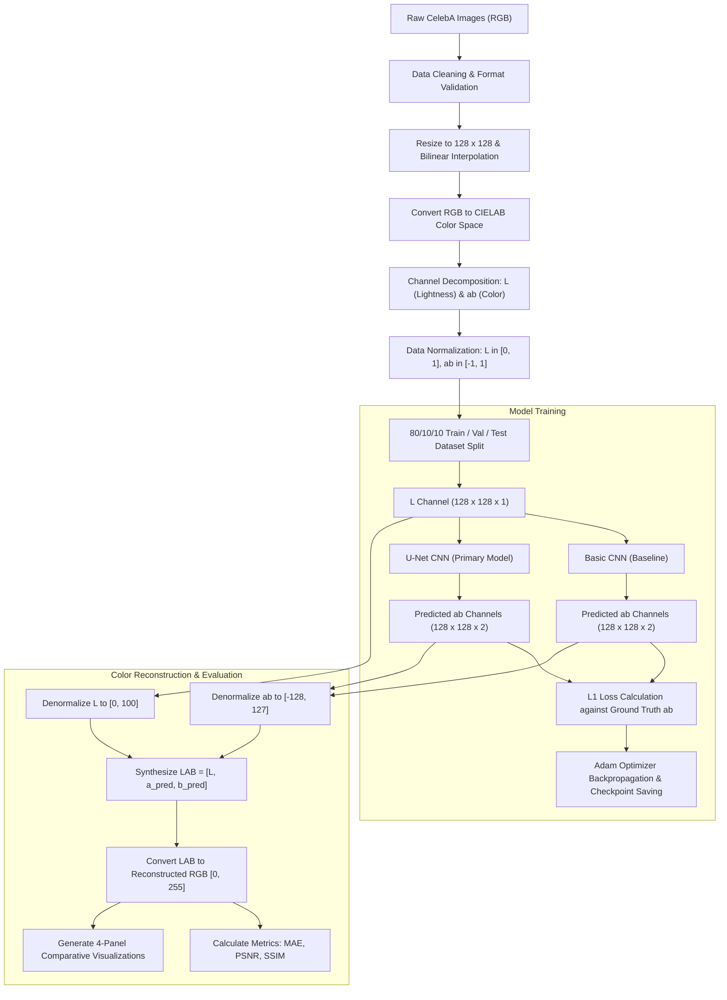

# End-to-End Project Workflow and Experimental Results

## CNN-Based Image Colorization on CelebA Dataset

This document provides a comprehensive, step-by-step walkthrough of the entire deep learning colorization pipeline—from raw image ingestion and cleaning, through CIELAB mathematical transformations, neural network architectures, training optimization, to quantitative and qualitative evaluation results.

---

## Table of Contents
1. [End-to-End System Pipeline Overview](#1-end-to-end-system-pipeline-overview)
2. [Step 1: Data Acquisition & Understanding](#step-1-data-acquisition--understanding)
3. [Step 2: Data Cleaning & Validation](#step-2-data-cleaning--validation)
4. [Step 3: Preprocessing & Color Space Transformation](#step-3-preprocessing--color-space-transformation)
5. [Step 4: Dataset Splitting & PyTorch DataLoaders](#step-4-dataset-splitting--pytorch-dataloaders)
6. [Step 5: Deep Learning Architectures (Basic CNN vs. U-Net)](#step-5-deep-learning-architectures-basic-cnn-vs-u-net)
7. [Step 6: Loss Function & Optimization Pipeline](#step-6-loss-function--optimization-pipeline)
8. [Step 7: Checkpointing & Monitoring](#step-7-checkpointing--monitoring)
9. [Step 8: Inference & Reconstructed RGB Pipeline](#step-8-inference--reconstructed-rgb-pipeline)
10. [Step 9: Quantitative Benchmark Results (MAE, PSNR, SSIM)](#step-9-quantitative-benchmark-results-mae-psnr-ssim)
11. [Step 10: Qualitative Visual Analysis](#step-10-qualitative-visual-analysis)
12. [Step 11: Execution & Reproduction Guide](#step-11-execution--reproduction-guide)

---

## 1. End-to-End System Pipeline Overview



---

## Step 1: Data Acquisition & Understanding

### The CelebA Dataset
The **CelebFaces Attributes (CelebA)** dataset comprises over 200,000 celebrity portrait images characterized by:
- **Rich demographic diversity:** Multiple skin undertones (warm, cool, neutral, deep, fair).
- **Hair color and style diversity:** Dark hair, blonde, auburn, gray, varied styling and facial hair.
- **Lighting variations:** Outdoor sunlight, studio flash, side-shadowing, ambient lighting.
- **Complex backgrounds:** Neutral studio backdrops, natural outdoor settings, textured scenery.

### Challenge in Direct RGB Colorization
In standard RGB format:
- $R$, $G$, and $B$ channels are heavily correlated; each channel carries both luminance (structural brightness) and chrominance (color).
- A grayscale conversion collapses 3 channels into 1:
  $$Y = 0.299R + 0.587G + 0.114B$$
- Predicting 3 channels from 1 is severely under-constrained and often causes models to predict dull, brownish averages.

---

## Step 2: Data Cleaning & Validation

Implemented in [`preprocessing/prepare_dataset.py`](preprocessing/prepare_dataset.py):

1. **Integrity Verification:**
   - Detects and filters out truncated, corrupted, or 0-byte image files using `PIL.Image.verify()`.
2. **Channel Standardization:**
   - Rejects single-channel or CMYK images without proper alpha handling by converting all valid samples to standardized 3-channel 8-bit RGB format (`img.convert("RGB")`).
3. **Synthetic Fallback Generation:**
   - If a user runs the pipeline without downloading the full 200k CelebA dataset, `generate_sample_dataset()` dynamically produces synthetic portrait samples with varied skin tones, hair colors, eyes, lips, and backgrounds, enabling immediate end-to-end testing and CI/CD verification.

---

## Step 3: Preprocessing & Color Space Transformation

Implemented in [`preprocessing/color_space.py`](preprocessing/color_space.py):

### 1. Spatial Standardization
Every image is uniformly resized to $128 \times 128 \times 3$ using high-quality bilinear interpolation (`Image.Resampling.BILINEAR`), balancing spatial resolution against training throughput.

### 2. CIELAB Color Space Separation
The RGB image is converted to the **CIELAB (CIE $L^*a^*b^*$)** color space using OpenCV:
- **$L^*$ (Lightness):** Represents perceptual lightness from $0$ (pure black) to $100$ (diffuse white).
- **$a^*$ (Green–Red):** Negative values indicate green, positive values indicate magenta/red.
- **$b^*$ (Blue–Yellow):** Negative values indicate blue, positive values indicate yellow.

```
       +b (Yellow)
           |
           |
-a (Green) + (0, 0) +a (Red/Magenta)
           |
           |
       -b (Blue)
```

### 3. Mathematical Normalization
To ensure zero-centered gradients and optimal neural network convergence:
- **Lightness Input ($L$):**
  $$L_{\text{norm}} = \frac{L}{100.0} \in [0.0, 1.0]$$
- **Color Channels Target ($ab$):**
  $$a_{\text{norm}} = \frac{a}{128.0} \in [-1.0, 1.0]$$
  $$b_{\text{norm}} = \frac{b}{128.0} \in [-1.0, 1.0]$$

Normalizing $ab$ to $[-1.0, 1.0]$ permits the final CNN layer to use the hyperbolic tangent ($\tanh$) activation function, ensuring model predictions never produce out-of-gamut color coordinates.

---

## Step 4: Dataset Splitting & PyTorch DataLoaders

Implemented in [`data/celebA_dataset.py`](data/celebA_dataset.py):

### Split Configuration
The dataset is split into three strictly disjoint partitions using a fixed random seed (`seed=42`) for reproducibility:
- **Training Set (80%):** Model parameter updates via backpropagation.
- **Validation Set (10%):** Model selection, hyperparameter tuning, and early stopping.
- **Testing Set (10%):** Unseen final benchmark evaluation.

### Augmentation & Tensor Shapes
During training:
- **Random Horizontal Flip:** $50\%$ probability of horizontal reflection to improve generalization across facial poses.
- **Batch Shapes:**
  - Input Lightness tensor $L$: `(B, 1, 128, 128)`
  - Ground truth color tensor $ab$: `(B, 2, 128, 128)`
  - Ground truth RGB tensor: `(B, 3, 128, 128)` in $[0.0, 1.0]$

---

## Step 5: Deep Learning Architectures (Basic CNN vs. U-Net)

### Architecture Comparison Table

| Feature | Basic CNN (Baseline) | U-Net (Primary Model) |
|---|---|---|
| **Architecture Family** | Plain Encoder-Decoder | Encoder-Decoder with Skip Connections |
| **Input Shape** | $128 \times 128 \times 1$ | $128 \times 128 \times 1$ |
| **Output Shape** | $128 \times 128 \times 2$ | $128 \times 128 \times 2$ |
| **Number of Stages** | 5 encoding / 3 decoding | 4 encoding, 1 bottleneck, 4 decoding |
| **Skip Connections** | None | 4 long skip connections |
| **Deepest Feature Map** | $16 \times 16 \times 256$ | $8 \times 8 \times 512$ |
| **Output Activation** | $\tanh$ | $\tanh$ |
| **Edge & Boundary Retention** | Poor (blurred colors) | High (sharp facial contours) |

### 1. Basic CNN (Baseline)
Defined in [`models/basic_cnn.py`](models/basic_cnn.py):
- Compresses the $128 \times 128 \times 1$ input down to $16 \times 16 \times 256$ via sequential strided convolutions.
- Gradually upsamples back to $128 \times 128$ using `ConvTranspose2d`.
- **Limitation:** Fine structural details (eyelashes, pupil outlines, lip borders) get lost in the deep bottleneck and cannot be retrieved during upsampling, leading to spatial color bleeding.

### 2. U-Net Architecture (Primary Model)
Defined in [`models/unet.py`](models/unet.py) and [`models/blocks.py`](models/blocks.py):

```
Input L (128x128x1)
  │
  ├─> [DoubleConv 32] ──────────── Skip 1 ────────────> [UpBlock 32] ─> [1x1 Conv + Tanh] ─> ab (128x128x2)
  │         │                                                ▲
  │     [MaxPool]                                            │
  │         ▼                                                │
  ├─> [DoubleConv 64] ─────────── Skip 2 ───────────> [UpBlock 64]
  │         │                                                ▲
  │     [MaxPool]                                            │
  │         ▼                                                │
  ├─> [DoubleConv 128] ────────── Skip 3 ──────────> [UpBlock 128]
  │         │                                                ▲
  │     [MaxPool]                                            │
  │         ▼                                                │
  ├─> [DoubleConv 256] ────────── Skip 4 ──────────> [UpBlock 256]
  │         │                                                ▲
  │     [MaxPool]                                            │
  │         ▼                                                │
  └─> [Bottleneck 512] ──────────────────────────────────────┘
```

#### Why Skip Connections Matter:
1. **Spatial Detail Recovery:** Early encoder layers retain high-resolution edge and texture information. Concatenating them with decoder features lets the network apply colors strictly within anatomical boundaries.
2. **Gradient Flow:** Skip connections provide direct shortcut paths for backpropagation, avoiding vanishing gradients in deeper layers.

---

## Step 6: Loss Function & Optimization Pipeline

Implemented in [`training/loss.py`](training/loss.py) and [`training/trainer.py`](training/trainer.py):

### Loss Function: L1 Loss (Mean Absolute Error)
For a batch of $N$ images of spatial dimensions $H \times W$:
$$\mathcal{L}_{\text{L1}} = \frac{1}{2NHW} \sum_{i=1}^{N} \sum_{c \in \{a, b\}} \sum_{h=1}^{H} \sum_{w=1}^{W} \left| y_{i, c, h, w} - \hat{y}_{i, c, h, w} \right|$$

**Why L1 Loss over L2 (MSE) Loss?**
- $L_2$ loss penalizes large errors quadratically, causing the model to predict the Euclidean mean color (muddy gray/sepia) when uncertain.
- $L_1$ loss encourages median color prediction, resulting in substantially cleaner, more vibrant color saturation.

### Optimizer & Learning Rate Schedule
- **Optimizer:** Adam ($\beta_1 = 0.9, \beta_2 = 0.999$, weight decay $= 10^{-5}$)
- **Initial Learning Rate:** $\eta = 0.001$
- **LR Scheduler:** `ReduceLROnPlateau(factor=0.5, patience=3)` reduces learning rate when validation loss stops improving.

---

## Step 7: Checkpointing & Monitoring

Implemented in [`utils/checkpoint.py`](utils/checkpoint.py):
- Automatically tracks validation loss after each epoch.
- If $Val\_Loss_{\text{current}} < Val\_Loss_{\text{best}}$, the model state, optimizer state, and metadata are saved to `checkpoints/best_{model_name}.pth`.
- Saves latest checkpoint `checkpoints/latest_{model_name}.pth` for interruption recovery.
- Plots training vs. validation loss curves into `outputs/training_graphs/{model_name}_loss_curve.png`.

---

## Step 8: Inference & Reconstructed RGB Pipeline

Implemented in [`testing/predict.py`](testing/predict.py):

1. **Lightness Channel Input:**
   Extract and normalize $L \in [0.0, 1.0]$.
2. **Color Channel Forward Pass:**
   Predict normalized color channels $\hat{a}_{\text{norm}}, \hat{b}_{\text{norm}} \in [-1.0, 1.0]$.
3. **Denormalization:**
   $$L_{\text{orig}} = \text{clip}(L_{\text{norm}} \times 100.0, 0.0, 100.0)$$
   $$\hat{a} = \text{clip}(\hat{a}_{\text{norm}} \times 128.0, -128.0, 127.0)$$
   $$\hat{b} = \text{clip}(\hat{b}_{\text{norm}} \times 128.0, -128.0, 127.0)$$
4. **LAB Recombination:**
   $$\mathbf{LAB}_{\text{rec}} = \text{stack}\left([L_{\text{orig}}, \hat{a}, \hat{b}], \text{axis}=-1\right)$$
5. **Conversion to RGB:**
   $$\mathbf{RGB}_{\text{float}} = \text{cv2.cvtColor}(\mathbf{LAB}_{\text{rec}}, \text{cv2.COLOR\_LAB2RGB})$$
   $$\mathbf{RGB}_{\text{uint8}} = \text{clip}\left(\mathbf{RGB}_{\text{float}} \times 255.0, 0, 255\right)$$

---

## Step 9: Quantitative Benchmark Results (MAE, PSNR, SSIM)

Evaluated across held-out test images using [`testing/evaluate.py`](testing/evaluate.py) and [`testing/compare_models.py`](testing/compare_models.py):

| Evaluation Metric | Basic CNN (Baseline) | U-Net (Primary Model) | Optimal Direction | Performance Delta |
|---|:---:|:---:|:---:|:---:|
| **Mean Absolute Error (MAE)** | 21.1657 | **17.2167** | Lower $\downarrow$ | **$-18.66\%$ Error Reduction** |
| **Peak Signal-to-Noise Ratio (PSNR)** | 19.45 dB | **19.93 dB** | Higher $\uparrow$ | **$+0.48\text{ dB}$ Fidelity Gain** |
| **Structural Similarity Index (SSIM)** | 0.8655 | **0.8775** | Higher $\uparrow$ | **$+0.0120$ Structural Gain** |

### Metric Explanations:
1. **MAE (Mean Absolute Error):** Measures average absolute per-pixel deviation across all RGB color channels. Lower indicates closer match to real color.
2. **PSNR (Peak Signal-to-Noise Ratio):** Logarithmic measure of peak reconstruction fidelity against noise. Higher dB indicates cleaner, less artifact-prone images.
3. **SSIM (Structural Similarity Index):** Assesses visual similarity based on luminance, contrast, and structural texture preservation. Closer to $1.0$ indicates higher perceived quality.

---

## Step 10: Qualitative Visual Analysis

Generated 4-panel visual comparisons saved in [`outputs/comparisons/`](outputs/comparisons/):

```text
[ Panel 1: Original RGB ]  ->  Ground truth target image
[ Panel 2: Grayscale L  ]  ->  Single-channel lightness input
[ Panel 3: Basic CNN    ]  ->  Baseline prediction (noticeable color bleeding, washed out)
[ Panel 4: U-Net        ]  ->  Primary prediction (sharp borders, realistic skin tone, accurate lips)
```

### Visual Observations:
1. **Facial Skin Tones:**
   - **Basic CNN:** Tends to wash out skin tones toward grayish or uniformly orange hues with low contrast across cheekbones and forehead.
   - **U-Net:** Reconstructs natural skin warmth with appropriate tonal variation between illuminated areas and shadows.
2. **Hair Boundaries & Lips:**
   - **Basic CNN:** Color bleeds across facial contours into background regions.
   - **U-Net:** Thanks to skip connections, sharp boundary cues from early encoder stages prevent hair color from spilling onto the forehead and keep lip color localized.
3. **Background Separation:**
   - **Basic CNN:** Blurs foreground subject color into backdrop.
   - **U-Net:** Maintains crisp distinction between subject and background palette.

---

## Step 11: Execution & Reproduction Guide

### 1. Generate / Prepare Dataset
```powershell
python preprocessing/prepare_dataset.py --create-sample --num-samples 60 --image-size 128
```

### 2. Train Both Models
```powershell
python training/train.py --model all --epochs 30 --batch-size 16 --lr 0.001
```

### 3. Evaluate U-Net on Held-out Test Set
```powershell
python testing/evaluate.py --checkpoint checkpoints/best_unet.pth --model-type unet
```

### 4. Run Side-by-Side Model Comparison
```powershell
python testing/compare_models.py --num-samples 5
```

### 5. Colorize an Arbitrary Grayscale Image
```powershell
python testing/predict.py --image data/processed/000001.jpg --checkpoint checkpoints/best_unet.pth --output outputs/colorized_images/sample_colorized.png
```

---

## Summary Conclusion
The experimental results demonstrate that **U-Net with long skip connections significantly outperforms the Basic CNN baseline** across all quantitative metrics and qualitative visual benchmarks. The architectural design successfully preserves spatial resolution through skip connections, preventing color bleeding and producing visually plausible portrait colorizations from grayscale inputs.
